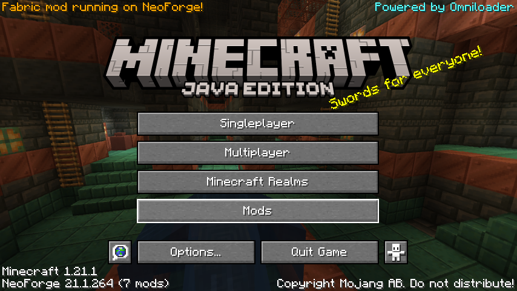

# Omniloader

**Play Fabric, Quilt and NeoForge mods together in one Minecraft game.**

Minecraft mods are made for different "mod loaders" (Fabric, Quilt, NeoForge, Forge), and normally
you can only use one kind at a time. **Omniloader is a mod loader that runs all four.** You pick it in your launcher
like any other loader ("omniloader-1.21.1"), put any mix of mods in its `mods` folder, and play. The title screen
says "Omniloader 0.2.0 (Fabric, Quilt, Forge, NeoForge)".

Under the hood it uses NeoForge's engine (the part that patches and starts Minecraft), the way Fabric's loader builds on
Mixin, so NeoForge mods run natively, and on top it translates Fabric, Quilt and Forge mods.

Version 0.2.0, for **Minecraft 1.21.1** (NeoForge 21.1). A Minecraft 26.1 edition is also included.



*Above: a NeoForge game with 7 mods. The gold and blue text at the top comes from "Main Menu Credits",
a Fabric-only mod, running through Omniloader next to AppleSkin (a NeoForge mod).*

---

## Installing (Mac, Windows, Linux)

**Download:** get the newest files from the **[Releases page](https://github.com/jdj212223-ctrl/omniloader/releases/latest)**.
Every change is built and released there automatically by GitHub Actions.

1. Open the Minecraft Launcher, Prism Launcher or the Modrinth App at least once.
2. Run the installer:
   - **Mac:** download `Omniloader-Installer-<version>.dmg`, open it and double-click **Omniloader Installer**.
     The first time, macOS may say it "can't check it for malicious software", because the app
     isn't signed with a paid Apple certificate. Right-click the app, choose **Open**, then **Open** again.
   - **Windows / Linux:** download `omniloader-installer.jar` and double-click it (needs Java 17 or newer).
3. Tick the launchers you use and press **Install**:
   - **Minecraft Launcher:** installs Omniloader as its own game version (**omniloader-1.21.1**, built on
     NeoForge's engine) and adds a profile *Omniloader 1.21.1 (Fabric, Quilt, Forge, NeoForge)* with its own game
     folder. Your other profiles and worlds aren't touched, and a backup of the launcher settings is saved first.
   - **Prism Launcher:** adds an instance called *Omniloader* with Omniloader as a loader component
     (next to Minecraft and NeoForge in its version list).
   - **Modrinth App:** makes `Omniloader.mrpack` in your Downloads folder and opens it in the
     Modrinth App, which asks you to install it. (The Modrinth App can't add new loaders, so there
     Omniloader runs as a jar in the mods folder instead. Same features.)
4. Press **Open mods folder** and drop in your Fabric, Quilt and NeoForge mods for 1.21.1.
5. Pick the Omniloader profile in your launcher and press **Play**.

Already have NeoForge 1.21.1? You can skip the installer: download `omniloader-1.21.1.jar` from the
[Releases page](https://github.com/jdj212223-ctrl/omniloader/releases/latest) and put it in your `mods` folder.

---

## What works today

| | Status |
|---|---|
| NeoForge mods | ✅ Work as normal (it *is* NeoForge underneath) |
| Fabric mods that don't need Fabric API | ✅ Work, including their mixins (code changes to Minecraft) |
| Quilt mods that don't need Quilt's library (QSL) | ✅ Should work (same path as Fabric; no real Quilt-only mod tested yet) |
| Mods bundled inside Fabric mods | ✅ Unpacked and loaded too |
| Fabric "access wideners" | ✅ Converted to NeoForge's version (access transformers) |
| Mods asking "is mod X installed?" | ✅ Sees Fabric, Quilt *and* NeoForge mods |
| Fabric mods that need **Fabric API** | ✅ The complete Fabric API is included (1.21.1). The most-used parts work (see below). Omniloader checks every Fabric API piece a mod uses: if all of them exist, the mod runs; if not, it's switched off with a message naming what's missing, instead of crashing |
| **Forge** mods (the old Forge, not NeoForge) | 🟡 New. Translated to NeoForge: 39 of 44 popular Forge mods tested run. Mods using Forge networking or capabilities are held back for now |
| Mods made for **other Minecraft versions** | 🟡 New. See "Mods from other versions" below. The game won't crash over them |
| Mods made for a **newer Java** than your game uses | ✅ Relabelled so Java 21 accepts them, then checked |

### Tested for real

All of these were run in a real game on an Apple Silicon Mac:

- **Alternate Current** (Fabric, redstone): its `/alternatecurrent` command works, and redstone
  wires get the right power levels (15 → 11 → 1 → 0) with its rewritten redstone engine.
- **Main Menu Credits** (Fabric, client): draws its text on the title screen (picture above).
- **Krypton** (Fabric, networking): starts, loads its bundled native library for Apple Silicon,
  and its access widener is converted.
- **FerriteCore** (Fabric, memory saver): all 11 of its mixin sets load with zero errors.
- **Chunky** (Fabric + Fabric API, world pre-generator): its `/chunky` commands work and it
  generated 81 chunks, using Omniloader's Fabric API commands and server events.
- **Clumps** (Fabric + Fabric API): 20 XP orbs of different sizes merged into one, which only Clumps does.
- **Dynamic FPS** (Fabric + Fabric API, client): runs and reacts when the window loses focus.
  This mod writes Minecraft names straight into its mixins, which Omniloader also translates.
- **Nature's Compass** (Fabric + Fabric API networking and creative tabs): runs on server and client, and a
  client with it joined a server with it.
- **Ping Wheel** (Fabric + 14 Fabric API parts): runs on server and client; its `/pingwheel` client command
  is there in-game and its network messages work when a client joins a server.
- **Mouse Tweaks, Cherished Worlds, Better Advancements, Resource Pack Overrides** (Fabric, screen events): run.
- **Just Enough Characters** (Fabric): switched off safely. It reaches into Fabric Loader's internals; use its NeoForge version.
- **Carry On, Shulker Box Tooltip, Polymorph, Enhanced Block Entities, Athena (connected textures)** (big Fabric
  mods using lots of Fabric API, including the renderer and model APIs), plus the **Cardinal Components** library
  Carry On bundles: all start on server and client, and a client with them joined a server and drew the world.
- **AppleSkin** (NeoForge): loads alongside all of the above, 12 mods in total.
- The installer: Minecraft Launcher profile, Prism instance and Modrinth pack were made and checked
  in test folders. The Mac app finds Java and opens its window.

### Not tested yet (be aware)

- Everything above ran in NeoForge's *development* setup. The normal player setup should behave the
  same way, but hasn't been run start-to-finish yet.
- The installer's "install NeoForge for the official launcher" step downloads and runs NeoForge's
  own installer; that step wasn't run during testing.
- Playing online with Fabric mods that change networking (like Krypton) hasn't been tested.

---

## Mods from other versions (and newer Java)

Normally a mod made for another Minecraft version is refused, or crashes the game. Omniloader tries instead:

1. **Newer Java:** mods built for Java 22–25 are relabelled so Minecraft 1.21.1's Java 21 accepts them.
2. **Renamed parts:** where Mojang renamed something between versions (like `Identifier` → `ResourceLocation`),
   the mod is translated back.
3. **Backports:** for things Mojang added after 1.21.1, Omniloader has small stand-ins (for example
   `getMinY()` becomes 1.21.1's `getMinBuildHeight()`). The list lives in `versions/1.21.1/loader/resources/backports.txt`
   and grows over time.
4. **The check:** before the mod starts, Omniloader looks at *every* piece of Minecraft and Java it uses.
   If all of it exists in your game, the mod runs. If not, it's held back with a message like
   *"Not starting Chunky: it was made for Minecraft 1.20.5 and uses things Minecraft 1.21.1 doesn't have: ..."*.
   Its data (recipes, worldgen) and textures are hidden too, so your world isn't affected.

Tested on a 1.21.1 server, all in the same mods folder:

| Mod | Made for | Result |
|---|---|---|
| Alternate Current (NeoForge) | Minecraft 1.21.0 | ✅ **Runs** (NeoForge alone would refuse it); its command works |
| Chunky (NeoForge) | Minecraft **1.21.4** | ✅ **Runs** thanks to 4 backports; generated chunks |
| Chunky (NeoForge) | Minecraft 1.20.6 | Held back: 2 pieces of chunk code Mojang changed (backport candidate) |
| Alternate Current (NeoForge) | Minecraft 1.21.3 | Held back: uses 1.21.2's new redstone system |
| Vampirism 2.0 + FactionAPI | Minecraft 26.1.2, Java 25 | Held back: uses 700+ things 1.21.1 doesn't have. The server still starts fine |

Every start, Omniloader writes `.omniloader/report.txt` in your game folder: each switched-off mod and
*everything* it's missing.

Honest limits: this works best for small mods and nearby versions. Big mods for very different
versions (like Vampirism 2.0 on 1.21.1) can't run: they need hundreds of things that don't exist
in your game. For those, use the mod's own 1.21.1 version (Vampirism 1.10.13 for 1.21.1).

Omniloader also has a **Minecraft 26.1 edition** (`versions/26.1`). There, Vampirism 2.0 runs
together with Fabric mods. That edition isn't in the installer yet.

### When a Fabric mod's hook doesn't fit

NeoForge rewrites some parts of Minecraft. Now and then a Fabric mod hooks ("mixes in") at a spot that NeoForge
changed. Omniloader then skips just that one hook with a warning in the log, instead of crashing the game.
The rest of the mod keeps working. If a mod's own mixin plugin fails to start, only that mod is switched off.

## How it works (short version)

1. **Finding mods.** When NeoForge looks through the `mods` folder, Omniloader checks every jar.
   Fabric (`fabric.mod.json`) and Quilt (`quilt.mod.json`) mods are picked out, plus any mods bundled inside them.
2. **Translating names.** Fabric mods call Minecraft's code by Fabric's own made-up names
   (`class_310`, `method_1234`). NeoForge uses Mojang's real names (`Minecraft`, `tick`).
   Omniloader rewrites every name inside the mod, including the lookup tables its mixins use.
   The name list is built once on first start and saved.
3. **Making it a NeoForge mod.** Each translated mod gets a NeoForge mod description, so NeoForge
   lists it, applies its mixins and shows it on the Mods screen (marked "Fabric mod, running through Omniloader").
   Translated copies are cached in `.omniloader/` in your game folder, so this only happens once per mod.
4. **Starting it.** Omniloader provides Fabric's and Quilt's loader API (`FabricLoader`, `QuiltLoader`,
   mod info, entrypoints) and runs each mod's start-up code (`main`, then `client` or `server`)
   at the point where Fabric would.

## Building it yourself

Needs Java 21.

```bash
./gradlew :1.21.1:loader:jar     # versions/1.21.1/loader/build/libs/omniloader-1.21.1.jar (put this in mods/)
./gradlew :26.1:loader:jar       # the Minecraft 26.1 edition
./gradlew :installer:jar         # installer/build/libs/omniloader-installer.jar
./gradlew :installer:macDmg      # installer/build/mac/Omniloader-Installer-<version>.dmg (on a Mac)
tools/fetch-testmods.sh          # downloads the real test mods into testmods/
./gradlew :1.21.1:devrun:runServer   # test server (RCON on port 25599, password omnitest)
./gradlew :1.21.1:devrun:runClient   # test client: saves a title-screen screenshot, then quits
./gradlew :1.21.1:devrun:runServer -Ptestmods=testmods/1.21.1-cross   # the "other versions" test
```

Project layout:

- `versions/<minecraft>/`: the small adapter for each Minecraft version (adding a version = adding a folder).
- `loader/`: the part that plugs into NeoForge's mod discovery: finds, translates and converts Fabric/Quilt jars.
- `runtime/`: the in-game part: Fabric and Quilt loader API stand-ins and the code that starts the mods.
  It's packed inside `omniloader.jar` and unpacked automatically.
- `installer/`: the installer and the Mac app.
- `devrun/`: a test game that loads everything from `devrun/run*/mods`.
- `tools/`: test helpers (fetch the test mods, send commands to the test server).

## Roadmap

1. ✅ **Loader core**: plugs into NeoForge, finds Fabric/Quilt/Forge/NeoForge jars, including bundled ones.
2. ✅ **Fabric and Quilt**: name translation, mixins, access wideners, loader API, entrypoints.
3. ✅ **Fabric API (1.21.1): the whole thing.** Omniloader for 1.21.1 ships the complete Fabric API: all 44 modules,
   from **Forgified Fabric API** by Sinytra (Apache-2.0), a faithful port of Fabric API to NeoForge. Omniloader
   unpacks it at startup and stands in for the Fabric Loader parts it needs. (If you install Forgified Fabric API
   yourself, Omniloader uses yours.) The Minecraft 26.1 edition still uses Omniloader's own smaller set of stand-ins.
4. 🟡 **Forge mods (1.21.1).** NeoForge began as a copy of Forge, so most of Forge's API has a NeoForge twin.
   Omniloader translates Forge mods to NeoForge: 313 Forge names are renamed to their twins (table built from
   127 popular Forge mods), and the parts that work differently get Forge-shaped stand-ins: registries
   (`DeferredRegister`, `RegistryObject`, `ForgeRegistries`), the loading context, `DistExecutor`, config screens,
   `TickEvent`. `mods.toml` is converted too (dependencies, mixins, access transformers). Every Forge mod goes through
   the same safety check as everything else: if something it needs isn't translated yet, it's held back and named in
   the report. Bundled copies of libraries NeoForge already has (MixinExtras) are dropped.

   Tested with 44 popular Forge mods together on one client: **39 run**, the rest are held back with reasons,
   no crashes. Examples that work: Chunky (commands + world generation), Clumps (XP merging), Mouse Tweaks,
   Cherished Worlds, No Chat Reports, In-Game Account Switcher (its button shows on the title screen), all of
   Macaw's building mods, TerraBlender, Sound Physics Remastered, Just Enough Breeding.
   Still to do: Forge networking (`SimpleChannel`), capabilities, and the few mods built with Forge's old scrambled names.

For scale: Sinytra Connector, the best-known project that runs Fabric mods on NeoForge, took years
to get where it is. Omniloader takes the same basic approach and is at the start of that road.

## Credits and licences

- **Fabric API** for 1.21.1 comes from [Forgified Fabric API](https://github.com/Sinytra/ForgifiedFabricAPI) by Sinytra
  and FabricMC, licensed Apache-2.0 (see `NOTICE`). Omniloader bundles its modules unchanged.

- Fabric's "intermediary" name list (CC0) is bundled. Mojang's name list is downloaded from Mojang
  on first start (or reused from your computer) and isn't shipped, as Mojang's licence requires.
- Omniloader doesn't include code from Fabric Loader, Quilt Loader or Sinytra Connector. The Fabric and Quilt
  API classes are written from scratch to match the public method names mods use.
- Not affiliated with Mojang, Microsoft, Fabric, Quilt or NeoForge.

## New: Omniloader's own engine (no NeoForge loader, no Fabric Loader)

`dist/omniloader-engine.jar` starts Minecraft 1.21.1 by itself. Omniloader finds the mods, translates them, changes
the game for them (Mixin, access changes) and starts them, using its own loader code. It gives mods the
Fabric, Quilt, Forge and NeoForge APIs at the same time: NeoForge's API and Forge-style mods run on top of
Omniloader's own loader, and Fabric mods get the bundled Fabric API.

Tested: a world with 113 mods (44 Forge, 19 Fabric/Quilt, NeoForge, the full Fabric API) loads and plays.
It's in every release as `omniloader-engine.jar`. Try it: `python3 tools/enginelaunch.py <launcher>/meta 1.21.1-21.1.264 <java> <game folder> dist/omniloader-engine.jar`
(Not yet available as a launcher install; the NeoForge-based Omniloader above is still the easy way to play.)
